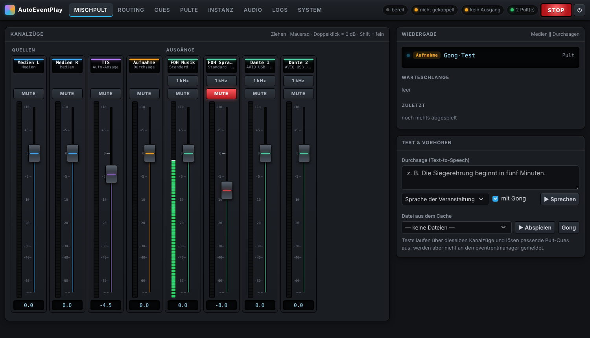
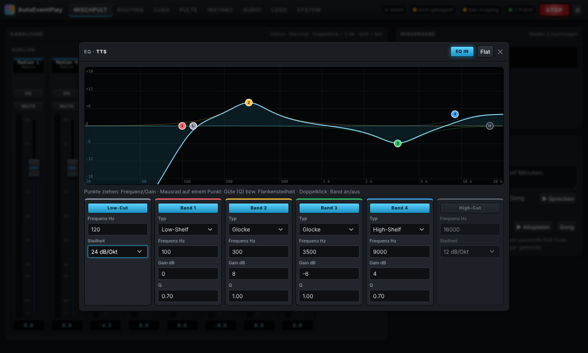

# AutoEventPlay

Lokaler Audio-Player für Veranstaltungen auf dem Raspberry Pi. AutoEventPlay koppelt sich mit einer
[eventrentmanager](../eventrentmanager)-Instanz, holt dort Jingles, Audio-Dateien, Text-Durchsagen und
aufgenommene Durchsagen ab, spielt sie über die Audio-Adapter des Pi aus und steuert dabei die
Mischpulte in der Signalkette (Kanäle entmuten, Pegel setzen, danach zurücksetzen).





## Funktionen

- **Kopplung per 6-stelligem Code** an eine Veranstaltung im eventrentmanager (alternativ Geräte-Token).
- **Lokaler Cache** aller Dateien der Veranstaltung – Abspielen funktioniert auch bei wackeligem Netz sofort.
- **Drei Quellen:** Medien (stereo, L und R getrennt routbar), automatische Durchsage (TTS, offline mit
  Piper bzw. espeak-ng) und aufgenommene Durchsagen – jeweils mit Gong.
- **Routing-Matrix** Quellen × Ausgänge, beliebig viele Ausgänge auf mehreren Audio-Adaptern gleichzeitig.
- **Fader** für jeden Ein- und Ausgang von −∞ bis +10 dB (Konsolen-Faderkurve), Mute, **Live-Meter**,
  Testton je Ausgang.
- **Equalizer** auf jedem Ein- und Ausgang: 4 vollparametrische Bänder (Glocke, Low-/High-Shelf, Frequenz,
  Gain ±18 dB, Q) plus Low-Cut und High-Cut (12/18/24 dB/Okt) – mit Frequenzgang-Kurve und ziehbaren Bandpunkten.
- **Pultsteuerung („Cues“):** Je Abspiel-Event (Auftragsart, optional bestimmte Datei oder Titel) Aktionen
  vor dem Abspielen (entmuten / muten / Pegel, optional mit Fade) mit Checkbox „danach zurücksetzen“ sowie
  Aktionen nach dem Wiedergabeende. Mehrere Pulte, auch gleichen Typs.
- **Unterstützte Pulte:** Behringer WING · Behringer X32 / Midas M32 · Behringer X-AIR / Midas M-AIR ·
  Yamaha TF, QL, CL, DM3, DM5, DM7 · Allen & Heath Qu (alt), SQ, Qu-5/6/7, Avantis, dLive ·
  Soundcraft Ui12/16/24R · Soundcraft Si und Vi (experimentell) ·
  generisches OSC-Pult (Adressen per JSON, ohne Programmieren).
- **Logs** live in der Weboberfläche, Download der Logdateien.
- **Login** mit lokalem Administrator-Konto (beim ersten Aufruf angelegt).

## Installation auf dem Raspberry Pi

Getestet für Raspberry Pi OS Bookworm (64-bit) auf Pi 4/5. Der Pi braucht während der Installation Internet.

```bash
git clone <dieses-repo> auto-event-play
cd auto-event-play
sudo ./deploy/install.sh
```

Das Skript installiert Systempakete (PortAudio, ffmpeg, espeak-ng), legt den Dienstbenutzer `aep` an,
richtet eine Python-Umgebung in `/opt/autoeventplay` ein, lädt Bootstrap (für den Offline-Betrieb) sowie
deutsche und englische Piper-Stimmen und startet den systemd-Dienst `autoeventplay`.

Danach im Browser `http://<pi-adresse>:8080/` öffnen, Administrator anlegen und unter **Instanz** die URL
des eventrentmanagers eintragen und den Kopplungs-Code eingeben.

Konfiguration des Dienstes: `/etc/autoeventplay.env` (Port, Datenverzeichnis, Log-Level).
Daten (SQLite-Datenbank, Datei-Cache, Logs, Stimmen): `/var/lib/autoeventplay`.

```bash
sudo systemctl status autoeventplay      # Status
journalctl -u autoeventplay -f           # Live-Log
```

## Entwicklung

```bash
python3 -m venv .venv && . .venv/bin/activate
pip install -r requirements-dev.txt
./scripts/fetch-vendor.sh                # optional: Bootstrap lokal
AEP_DATA_DIR=./data AEP_AUDIO_BACKEND=null python -m autoeventplay
pytest
```

Mit `AEP_AUDIO_BACKEND=null` läuft die Audio-Engine ohne Hardware (Meter und Routing funktionieren trotzdem).

## Einrichtung im Betrieb

1. **Audio › Ausgänge:** physische Kanäle der Audio-Adapter anlegen (z. B. „FOH Musik“ = USB-Interface Kanal 1).
2. **Routing:** Quellen auf Ausgänge schalten, z. B. Medien L+R → „FOH Musik“ (Mono-Summe),
   TTS + Aufnahme → „FOH Sprache“.
3. **Pulte:** Mischpulte mit IP-Adresse anlegen und mit „Testen“ prüfen.
4. **Cues:** z. B. „Bei Sprache: Kanal 31 entmuten, 0 dB, danach zurücksetzen“.
5. **Mischpult:** Pegel einstellen, mit den Testfunktionen vorhören.

## Pulte – Hinweise

| Pult | Protokoll | Port | Werte abfragbar |
|---|---|---|---|
| Behringer WING (alle Modelle) | OSC/UDP | 2223 | ja |
| Behringer X32 / Midas M32 (alle Modelle) | OSC/UDP | 10023 | ja |
| Behringer X-AIR / Midas M-AIR | OSC/UDP | 10024 | ja |
| Yamaha TF, QL, CL, DM3, DM5, DM7 | RCP (Text über TCP) | 49280 | ja |
| Allen & Heath Qu-16/24/32/Pac/SB | MIDI über TCP | 51325 | nein |
| Allen & Heath SQ-5/6/7, Qu-5/6/7 | MIDI über TCP (NRPN) | 51325 | ja |
| Allen & Heath dLive | MIDI über TCP | 51325 | ja |
| Allen & Heath Avantis | MIDI über TCP | 51325 | nein |
| Soundcraft Ui12/Ui16/Ui24R | WebSocket (wie die Ui-Weboberfläche) | 80 | ja |
| Soundcraft Si / Vi (experimentell) | HiQnet über TCP | 3804 | ja (mit Adress-Map) |

- **„Danach zurücksetzen“** stellt bei abfragbaren Pulten exakt den vorherigen Zustand wieder her. Bei der
  alten Qu-Serie wird ein Mute umgekehrt und der Pegel auf den eingetragenen Rücksetz-Pegel gestellt.
- Überlappen sich Wiedergaben (Jingle läuft, Durchsage kommt), wird erst nach dem Ende der letzten
  Wiedergabe zurückgesetzt.
- Soundcraft Ui wird nicht per OSC/HTTP, sondern über die WebSocket-Schnittstelle der Ui-Weboberfläche
  gesteuert. Die dB-Umrechnung der Ui-Fader ist eine Näherung und kann per Option kalibriert werden.
- A&H: Der MIDI-Kanal muss mit dem am Pult eingestellten übereinstimmen; bei SQ/Qu-5/6/7 außerdem die
  „NRPN Fader Law“ (Audio/Linear). Die alte Qu-Serie erlaubt nur **eine** TCP-MIDI-Verbindung gleichzeitig.
- **Yamaha:** Modell (z. B. CL5, TF3, DM7 Compact) im Pult auswählen – davon hängen Kanal- und Busanzahl ab.
  „ON“ bei Yamaha entspricht einem nicht gemuteten Kanal; das übersetzt der Treiber.
- **dLive/Avantis:** Das Pult belegt fünf MIDI-Kanäle ab dem eingestellten Basiskanal (Utility › Control › MIDI).
  Aux, Gruppen und Matrizen sind erst als Mono-, dann als Stereo-Busse durchnummeriert.
- **Soundcraft Si/Vi:** Soundcraft veröffentlicht für diese Serien keine Steuerschnittstelle; der Treiber
  spricht HiQnet wie ViSi Remote, die Parameter-Adressen müssen aber in der Adress-Map eingetragen werden
  (siehe [docs/mischpulte.md](docs/mischpulte.md#soundcraft-si--vi-hiqnet)). Bitte vor dem Einsatz testen.
- Weitere Fabrikate: siehe [docs/mischpulte.md](docs/mischpulte.md).

## Dante

Der Pi hat kein Dante an Bord. AutoEventPlay spielt auf jedes Gerät, das unter Linux als Soundkarte
erscheint – damit gibt es drei Wege:

1. **Dante-USB-Adapter** (z. B. Audinate AVIO USB): meldet sich als USB-Soundkarte; offiziell und
   zuverlässig. **Empfohlen.**
2. **Inferno** (Open Source, inoffiziell, experimentell): Dante-Implementierung als ALSA-Gerät, ohne
   Zusatzhardware. Nur für unkritische Einsätze.
3. **AES67**: Dante-Geräte im AES67-Modus können AES67-Streams empfangen (z. B. über PipeWire/AES67 auf
   dem Pi), erfordert PTP und Konfiguration im Dante Controller.

Eine rein softwarebasierte, offizielle Lösung wäre Audinates Embedded-Plattform (DEP) – lizenzpflichtig.

## Architektur

Python 3.11+, Starlette/Uvicorn, SQLite, Bootstrap 5, Server-Sent Events für die Live-Meter.
Aufbau nach **CQRS**: Schreibende Aktionen sind Commands, lesende Queries, mit getrennten Bussen.
Details: [docs/architektur.md](docs/architektur.md).

Schnittstelle zum eventrentmanager: `docs/abspielgeraet-api.md` im eventrentmanager-Repository.
