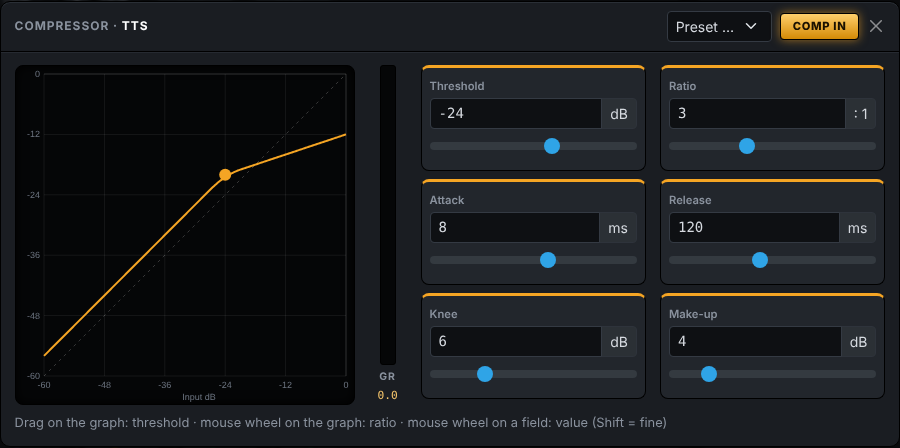

# AutoEventPlay

Local audio player for events, running on a Raspberry Pi. AutoEventPlay pairs with an
[eventrentmanager](../eventrentmanager) instance and fetches jingles, audio files, text announcements and
recorded announcements from it. It plays them through the Pi's audio adapters and controls the mixing
consoles further down the signal chain while doing so: it unmutes channels, sets levels and restores them
afterwards.

The web interface is in **English** by default and is also available in **German** (switch in the top
bar or under *System › Language*).




## Features

- **Pairing by 6-digit code** with an event in eventrentmanager. A device token works as an alternative.
- **Local cache** of all files of the event, so playback starts immediately even on a shaky network.
- **Three sources:**
  - media (stereo, with L and R routable separately)
  - automatic announcements (TTS, offline with Piper or espeak-ng)
  - recorded announcements

  Each source can play with a gong.
- **Routing matrix** of sources × outputs. You can have any number of outputs on several audio adapters at the same time.
- **Trim** on every input (−24 … +24 dB, rotary knob) to match the input level before EQ and compressor.
- **Faders** for every input and output from −∞ to +10 dB (console fader law), plus mute, **live meters**
  and a pink-noise test signal (−18 dBFS RMS) per output.
- **Equalizer** on every input and output:
  - 4 fully parametric bands (bell, low/high shelf, frequency, gain ±18 dB, Q)
  - low cut and high cut (12/18/24 dB/oct)
  - response curve with draggable band points
- **Compressor** on every input and output:
  - threshold, ratio (up to 20:1 ≈ limiter), attack, release, soft knee and make-up gain
  - transfer curve with the live level dot, gain-reduction meter in the editor and on every channel strip
  - presets for speech, music and limiter
- **EQ/compressor order** per channel: EQ → compressor (default) or compressor → EQ, swapped with the ⇅
  button between the EQ and DYN buttons. The order of the buttons on the strip shows the signal order.
- **Console control ("cues")** per playback event, matched by job type and optionally by a specific file or title:
  - actions before playback: unmute / mute / level, optionally with a fade
  - a "restore afterwards" checkbox
  - actions after playback has ended

  Several consoles can be controlled at once, including several of the same type.
- **Supported consoles:**
  - Behringer WING
  - Behringer X32 / Midas M32
  - Behringer X-AIR / Midas M-AIR
  - Yamaha TF, QL, CL, DM3, DM5, DM7
  - Yamaha LS9 (experimental)
  - Allen & Heath Qu (classic), SQ, Qu-5/6/7, Avantis, dLive
  - Mackie DL16S / DL32S / DL32R (experimental)
  - Soundcraft Ui12/16/24R
  - Soundcraft Si and Vi (experimental)
  - a generic OSC console (addresses as JSON, no programming)
- **Logs** live in the web interface, with download of the log files.
- **Login** with a local administrator account, created on first access.
- **Languages:** English (default) and German.

## Installation on the Raspberry Pi

Tested on Raspberry Pi OS Bookworm (64-bit) on a Pi 4/5. The Pi needs internet access during installation.

```bash
git clone <this-repo> auto-event-play
cd auto-event-play
sudo ./deploy/install.sh
```

The script:
- installs system packages (PortAudio, ffmpeg, espeak-ng)
- creates the service user `aep`
- sets up a Python environment in `/opt/autoeventplay`
- downloads Bootstrap (for offline use) and German and English Piper voices
- starts the systemd service `autoeventplay`

Then:
1. Open `http://<pi-address>:8080/` in a browser.
2. Create the administrator account.
3. Under **Instance**, enter the eventrentmanager URL and the pairing code.

- Service configuration: `/etc/autoeventplay.env` (port, data directory, log level).
- Data (SQLite database, file cache, logs, voices): `/var/lib/autoeventplay`.

```bash
sudo systemctl status autoeventplay      # status
journalctl -u autoeventplay -f           # live log
```

## Development

```bash
python3 -m venv .venv && . .venv/bin/activate
pip install -r requirements-dev.txt
./scripts/fetch-vendor.sh                # optional: Bootstrap locally
AEP_DATA_DIR=./data python -m autoeventplay
pytest
```

This plays through the computer's sound output (on macOS the `sounddevice` wheel brings its own PortAudio;
on Linux install `libportaudio2`). The status pill in the top bar shows how many audio devices are open;
details are under *Audio › Detected audio devices*.

`AEP_AUDIO_BACKEND=null` runs the audio engine **without any sound output** (for CI or a machine without
audio). Meters and routing still work, but nothing reaches the speakers.

### Translations

English is the source language. To translate:
- **Python:** use `Msg("Channel {n} does not exist", n=5)` for messages shown to users, or `t("…")` for
  immediate translation.
- **Templates:** use `{{ _("…") }}`.
- **JavaScript:** use `AEP.t("…", {params})`.

The German catalog is `autoeventplay/i18n/de.py` (English text → German). Texts missing from the catalog
are shown in English. `tests/test_i18n_web.py` renders every page in both languages.

## Setup in operation

1. **Audio › Outputs:** create the physical channels of the audio adapters (e.g. "FOH music" = USB interface channel 1).
2. **Routing:** route sources to outputs. For example:
   - Media L+R → "FOH music" (mono sum)
   - TTS + Recording → "FOH speech"
3. **Consoles:** add the consoles with their IP addresses and check them with "Test".
4. **Cues:** e.g. "For speech: unmute channel 31, 0 dB, restore afterwards".
5. **Mixer:** set trim, levels, EQ and compressor (and their order), and preview with the test functions.

## Consoles – notes

| Console | Protocol | Port | Values queryable |
|---|---|---|---|
| Behringer WING (all models) | OSC/UDP | 2223 | yes |
| Behringer X32 / Midas M32 (all models) | OSC/UDP | 10023 | yes |
| Behringer X-AIR / Midas M-AIR | OSC/UDP | 10024 | yes |
| Yamaha TF, QL, CL, DM3, DM5, DM7 | RCP (text over TCP) | 49280 | yes |
| Yamaha LS9 (experimental) | EtherMIDI (MIDI Parameter Change over TCP) | 12300 | yes |
| Allen & Heath Qu-16/24/32/Pac/SB | MIDI over TCP | 51325 | no |
| Allen & Heath SQ-5/6/7, Qu-5/6/7 | MIDI over TCP (NRPN) | 51325 | yes |
| Allen & Heath dLive | MIDI over TCP | 51325 | yes |
| Allen & Heath Avantis | MIDI over TCP | 51325 | no |
| Mackie DL16S / DL32S / DL32R (experimental) | Master Fader protocol over TCP | 50001 | yes |
| Soundcraft Ui12/Ui16/Ui24R | WebSocket (like the Ui web app) | 80 | yes |
| Soundcraft Si / Vi (experimental) | HiQnet over TCP | 3804 | yes (with address map) |

**Restoring after playback**
- On queryable consoles, **"restore afterwards"** brings back exactly the previous state.
- On the classic Qu series, a mute is inverted and the level is set to the configured restore level.
- If playbacks overlap (a jingle is running when an announcement comes in), the restore happens only
  after the last playback has ended.

**Per console**
- **Soundcraft Ui** is controlled through the WebSocket interface of the Ui web app, not OSC/HTTP. The dB
  conversion of the Ui faders is an approximation and can be calibrated with an option.
- **A&H:**
  - The MIDI channel must match the one set on the console.
  - On SQ/Qu-5/6/7, the "NRPN fader law" (audio/linear) must match too.
  - The classic Qu series allows only **one** TCP MIDI connection at a time.
- **Yamaha:**
  - Select the model (e.g. CL5, TF3, DM7 Compact) in the console settings. The channel and bus counts depend on it.
  - "ON" on Yamaha means an unmuted channel; the driver translates this.
- **Yamaha LS9:**
  - Enable *PARAMETER CHANGE* Rx/Tx in the MIDI setup.
  - Set the MIDI device number in the console options.
  - If the console asks for authentication, enter its MAC address.
  - The protocol is based on reverse engineering, so test it before use.
- **Mackie DL:**
  - Uses the same protocol as the Master Fader app. The model (DL16S, or DL32S/DL32R) is detected
    automatically.
  - DL1608/DL806 (iPad dock mixers) are not supported.
  - Based on the reverse engineering of the DigiMixer project, so test it before use.
- **dLive/Avantis:**
  - The console uses five MIDI channels starting at the configured base channel (Utility › Control › MIDI).
  - Aux, groups and matrices are numbered as mono buses first, then stereo buses.
- **Soundcraft Si/Vi:**
  - Soundcraft publishes no control interface for these series. The driver speaks HiQnet like ViSi Remote,
    but the parameter addresses have to be entered in the address map (see
    [docs/consoles.md](docs/consoles.md#soundcraft-si--vi-hiqnet)).
  - Test it before use.

Other brands: see [docs/consoles.md](docs/consoles.md).

## Dante

The Pi has no Dante on board. AutoEventPlay plays to any device that appears as a sound card under Linux,
which gives three options:

1. **Dante USB adapter** (e.g. Audinate AVIO USB): shows up as a USB sound card; official and reliable.
   **Recommended.**
2. **Inferno** (open source, unofficial, experimental): Dante implementation as an ALSA device, without
   extra hardware. Only for non-critical use.
3. **AES67:** Dante devices in AES67 mode can receive AES67 streams (e.g. via PipeWire/AES67 on the Pi).
   This requires PTP and configuration in Dante Controller.

A purely software-based official solution would be Audinate's Embedded Platform (DEP), which requires a licence.

## Architecture

Python 3.11+, Starlette/Uvicorn, SQLite, Bootstrap 5, and Server-Sent Events for the live meters.
The code follows **CQRS**: writing actions are commands and reading actions are queries, each on its own bus.
Details: [docs/architecture.md](docs/architecture.md).

The eventrentmanager interface is described in `docs/abspielgeraet-api.md` in the eventrentmanager repository.
